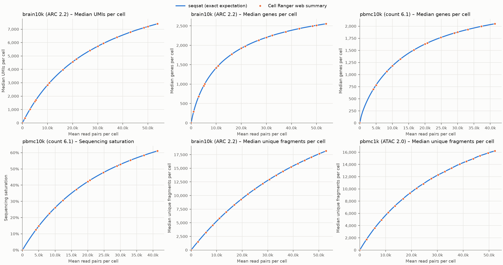

# seqsat

[](https://github.com/SeppeDeWinter/seqsat/actions/workflows/ci.yml)

Sequencing saturation for 10x Genomics single-cell RNA-seq and ATAC-seq, computed from
Cell Ranger outputs.

seqsat reproduces the subsampling curves in Cell Ranger's `web_summary.html`, fits a
saturation curve to each one and reports how many more reads you need to reach a target.

| Modality | Curves |
|---|---|
| GEX | median UMIs per cell, median genes per cell, sequencing saturation |
| ATAC | median unique fragments per cell, duplication |

All curves use mean raw read pairs per cell on the x-axis, as in the web summary.

Supported pipelines: `cellranger count` (GEX), `cellranger-atac count` (ATAC) and
`cellranger-arc count` (Multiome, both modalities).

## Installation

seqsat needs Python ≥ 3.12. All dependencies install from pre-built wheels.

```bash
uv tool install git+https://github.com/SeppeDeWinter/seqsat   # puts `seqsat` on your PATH
```

Or from a clone:

```bash
git clone https://github.com/SeppeDeWinter/seqsat.git && cd seqsat
uv run seqsat --help
```

## Usage

Point seqsat at a Cell Ranger `outs/` directory:

```bash
seqsat arc  path/to/outs --out results/sample   # cellranger-arc count
seqsat gex  path/to/outs --out results/sample   # cellranger count
seqsat atac path/to/outs --out results/sample   # cellranger-atac count
```

Options (see `seqsat <command> --help`):

| Option | Default | Meaning |
|---|---|---|
| `--targets 0.5 0.7 0.9` | `0.5 0.7 0.9` | Targets: fractions of the fitted maximum for counts, saturation values for sequencing saturation and duplication |
| `--total-reads N` (`--gex-total-reads`, `--atac-total-reads` for `arc`) | from the summary CSV | Sequenced read pairs, the x-axis denominator |
| `--cells FILE` | the pipeline's cell calls | Cell barcodes, one per line (plain or gzipped) |
| `--n-points N` | `100` | Evenly spaced depths per curve |

Files read from `outs/`:

| Pipeline | Files |
|---|---|
| `cellranger count` | `molecule_info.h5`, `metrics_summary.csv` |
| `cellranger-atac count` | `fragments.tsv.gz`, `singlecell.csv`, `summary.csv` |
| `cellranger-arc count` | `gex_molecule_info.h5`, `atac_fragments.tsv.gz`, `per_barcode_metrics.csv`, `summary.csv` |

For GEX, seqsat uses the Gene Expression libraries and features of the molecule info file.

## Outputs

| File | Contents |
|---|---|
| `curves.csv` | One row per curve point: `modality, metric, rate, mean_reads_per_cell, value` |
| `fits.json` | Per metric: fitted parameters ± SE, R², current depth and value, current saturation, marginal gain per 1,000 extra reads per cell, and per target the required reads per cell, extra reads per cell and extra total reads |
| `saturation.png` | One panel per metric: curve points, fitted curve, target lines labelled with the reads needed, and the current depth |

A summary table is also printed:

```
                     metric   now saturation target reads/cell extra reads
 GEX – Median UMIs per cell  7403      63.2%    50%      31.4k           0
 GEX – Median UMIs per cell  7403      63.2%    70%      73.3k      199.4M
 ...
```

## Method

seqsat computes the exact expected value of binomial read thinning at each depth.

If each read is kept with probability `p`, an item supported by `k` reads survives with
probability `s(k) = 1 − (1 − p)^k`. By linearity of expectation, a cell's expected number
of detected items is the sum of `s(k)` over its items. Items with the same `k` behave
the same, so each modality is summarised as a sparse cells × `k` histogram `H`, and the
curve value at rate `p` is `median(H · s(p))`.

| Metric | Item | `k` |
|---|---|---|
| UMIs per cell | molecule | reads of the molecule (`count` in molecule_info) |
| Genes per cell | (cell, gene) | reads summed over the gene's molecules in the cell |
| Unique fragments per cell | fragment | `readSupport` in the fragments file |

- **x-axis:** `p · total read pairs / number of cells`.
- **Sequencing saturation / duplication:** `1 − E[items](p) / (p · total item reads)` over
  all barcodes.
- **Exact endpoint:** at `p = 1` every observed item survives, so the endpoint equals the
  observed value.
- **Fit:** each curve is fitted with a Michaelis–Menten curve `y = vmax · x / (km + x)`.
  - A target fraction `f` of `vmax` is reached at `x = km · f / (1 − f)`.
  - For sequencing saturation and duplication, the depth for a target `S_t` is
    `x_now · (1 − S_now)/S_now · S_t/(1 − S_t)`.
  - Targets far beyond the current depth are extrapolations of the fit.

## Validation

Cell Ranger plots its own subsampling curves in `web_summary.html`. seqsat evaluates its
expected curve at Cell Ranger's x values and compares point by point. Datasets are public
10x Genomics datasets:

| Dataset | Pipeline |
|---|---|
| brain10k: 10k Human Brain Nuclei, GEM-X Multiome | `cellranger-arc` 2.2.0 |
| pbmc10k: 10k PBMC 3′ NextGEM, Chromium X | `cellranger` 6.1.0 |
| pbmc1k: 1k PBMC NextGEM | `cellranger-atac` 2.0.0 |



Largest relative difference over each curve's points:

| Dataset | Curve | Max difference |
|---|---|---|
| brain10k | median UMIs per cell | 0.27% |
| brain10k | median genes per cell | 0.13% |
| brain10k | median unique fragments per cell | 0.034% |
| pbmc10k | median genes per cell | 0.15% |
| pbmc10k | sequencing saturation | 0.019% |
| pbmc1k ATAC | median unique fragments per cell | < 0.0001% |

**GEX:** Cell Ranger plots one random subsample per point, so its values scatter
slightly around the exact expectation.

**ATAC:** Cell Ranger's curve is an expectation too:
- `cellranger-atac` matches exactly.
- `cellranger-arc` sits about 0.016% above seqsat, because its per-barcode fragment counts
  include a few fragments (about 8 per million) beyond those in `atac_fragments.tsv.gz`.

**Endpoints at full depth:**
- UMI and gene medians match Cell Ranger's reported values for all datasets, including a
  `cellranger` 3.0 dataset.
- Sequencing saturation and duplication match to the reported precision.
- For ARC, each cell's UMI and gene counts equal `per_barcode_metrics.csv`.

The web-summary comparison reads reports from `cellranger` 6.x, `cellranger-atac` 2.x
and `cellranger-arc` 2.x.

## Development

The project is managed with [uv](https://docs.astral.sh/uv/).

```bash
uv sync
uv run pytest                     # fast unit tests
scripts/download_test_data.sh all # public test datasets into data/ (~4.3 GB)
uv run pytest -m slow             # integration tests on the downloaded data
uv run ruff check . && uv run ruff format .
uv run ty check
```

To regenerate the validation figure:

```bash
for d in brain10k:arc pbmc10k_gex:gex pbmc1k_atac:atac; do
  uv run seqsat "${d#*:}" "data/${d%%:*}" --out "results/${d%%:*}"
done
uv run python scripts/websummary_comparison.py docs/websummary_comparison.png \
  "brain10k (ARC 2.2)=data/brain10k:results/brain10k" \
  "pbmc10k (count 6.1)=data/pbmc10k_gex:results/pbmc10k_gex" \
  "pbmc1k (ATAC 2.0)=data/pbmc1k_atac:results/pbmc1k_atac"
```
